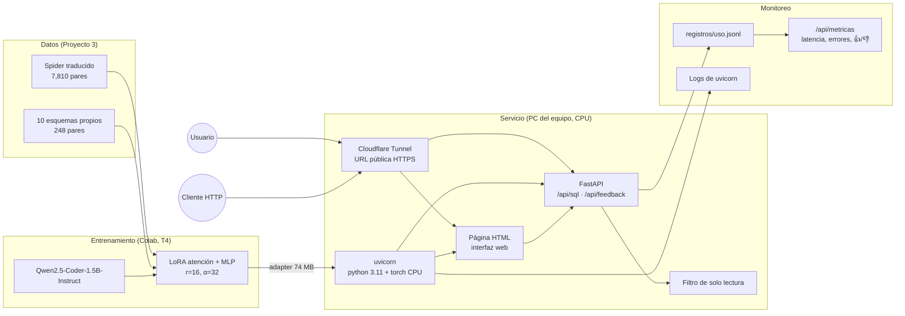

## 6. Herramientas y arquitectura



| Etapa | Herramienta | Por qué |
|---|---|---|
| Datos | MySQL 8.4.10, MarianMT | Mismo motor que usará el usuario; todas las consultas de entrenamiento se validaron por ejecución |
| Entrenamiento | `transformers`, `peft`, Colab T4 | LoRA entrena 18 M de 1,500 M parámetros y cabe en una GPU gratuita |
| Modelo | Base + adapter fusionados con `merge_and_unload` | Sin sobrecosto de LoRA en cada inferencia |
| Servicio | FastAPI que sirve la API y una página HTML | La interfaz usa la misma API que cualquier cliente; sin dependencias de frontend |
| Despliegue | PC del equipo + Cloudflare Tunnel | URL pública HTTPS temporal sin abrir puertos. Su disponibilidad depende de la PC, la conexión y el proceso del túnel |
| Portabilidad | `Dockerfile` | La misma imagen corre en cualquier nube con ≥ 8 GB de RAM (Cloud Run, una VM) si el servicio se mantiene |
| Seguridad | `es_solo_lectura` | Se revisan el inicio de la consulta, patrones de escritura y varias sentencias. El filtro no sustituye la revisión del SQL ni los permisos de lectura en MySQL |
| Monitoreo | JSONL + `/api/metricas` + logs de uvicorn | Cada solicitud guarda pregunta, SQL, latencia y si se bloqueó; el feedback 👍/👎 mide calidad percibida |

### Decisiones

- **CPU en lugar de GPU.** En la corrida registrada con adapter B en fp32, la carga tomó 17.3 segundos y la latencia del servicio fue de 27.03 segundos en p50 y 42.79 segundos en p95. La memoria estable fue de 6.31 GB. Estas cifras corresponden a solicitudes secuenciales y no acreditan el tiempo completo por la URL pública.
- **Una generación a la vez.** Un candado serializa `generate`. Las solicitudes simultáneas esperan su turno y requieren una prueba de carga para medir su efecto en la latencia.
- **Espera de la interfaz.** La página crea una tarea con `POST /api/tareas` y consulta su estado mediante peticiones breves cada dos segundos. Las tareas se generan de una en una y su respuesta se conserva para recuperarla al recargar la página. Este flujo evita mantener una conexión abierta durante toda la generación. `POST /api/sql` conserva la respuesta directa para evaluación y otros clientes.
- **Carga en segundo plano.** El modelo se carga al arrancar en un hilo; `/api/salud` dice `listo: false` mientras tanto, y la primera solicitud espera la carga.
- **Sin ejecución de SQL.** El servicio no se conecta a la base del usuario: devuelve la consulta y el usuario la revisa y ejecuta. Por eso no se usa el ciclo de autocorrección con `ejecutar` del Proyecto 3. Así el servicio no guarda credenciales ni datos de la base del usuario.
- **Privacidad del registro.** Se guardan la pregunta, el SQL y los comentarios de los votos. Del esquema solo se conserva su longitud. Los registros se revisan antes de compartirse y se utiliza información de demostración. Los endpoints de métricas y registros no tienen autenticación en esta versión.
- **Límites de entrada.** Esquema hasta 20,000 caracteres y pregunta hasta 500 (respuesta 422 si no se cumplen).

### API

| Método | Ruta | Entrada | Salida |
|---|---|---|---|
| POST | `/api/sql` | `{"esquema", "pregunta"}` | `{"id", "sql", "solo_lectura", "segundos"}` |
| POST | `/api/tareas` | esquema y pregunta | identificador de tarea y HTTP 202 |
| GET | `/api/tareas/{id}` | identificador en la ruta | estado y respuesta al completar la tarea |
| POST | `/api/feedback` | `{"id", "correcto", "comentario"}` | evento registrado (404 si el `id` no existe) |
| GET | `/api/salud` | | `{"listo", "modelo_base", "usar_adapter", "segundos_carga"}` |
| GET | `/api/metricas` | | solicitudes, errores, latencia p50/p95, tasa de solo lectura, votos y tasa de 👍 |
| GET | `/api/registros` | | registro completo en JSONL |
| GET | `/api/ejemplo` | | esquema de farmacia sin filas de datos |

### Ejecución

Local (Python 3.11):

```bash
python -m venv .venv
.venv/Scripts/pip install -r requirements.txt -r requirements-dev.txt
.venv/Scripts/python -m pytest
.venv/Scripts/python -m uvicorn servicio.api:app --port 7860
```

Publicar con URL pública (Windows, requiere [`cloudflared`](https://developers.cloudflare.com/cloudflare-one/connections/connect-networks/downloads/)):

```powershell
.\scripts\publicar.ps1
```

`cloudflared` imprime una URL `https://<nombre>.trycloudflare.com`. El servicio está disponible mientras el script y la PC estén encendidos; la URL cambia en cada ejecución.

El script inicia su propia instancia de uvicorn. Antes de ejecutarlo se libera el puerto 7860. Si el servidor ya está iniciado, se puede publicar desde otra terminal con `cloudflared tunnel --no-autoupdate --url http://127.0.0.1:7860`.

Docker (alternativa en cualquier máquina con ≥ 8 GB de RAM):

```bash
docker build -t texto-sql .
docker run -p 7860:7860 texto-sql
```

Variables: `USAR_ADAPTER=0` sirve el modelo base. `ADAPTER` cambia la ruta del adapter. `DIR_REGISTROS` cambia dónde se guarda el registro. `PRECARGAR=0` desactiva la carga al arrancar. `CUANTIZAR=0` conserva fp32 y es la configuración elegida. Las opciones `1` y `parcial` se reservan para reproducir los experimentos de int8.

El registro de uso queda en `registros/uso.jsonl` de la PC que sirve el modelo; también se puede descargar desde `/api/registros`.

Las instrucciones integradas y el montaje persistente de registros para Docker están en [README.md](../README.md). El protocolo de pruebas públicas y sesiones externas está en [evidencias/README.md](../evidencias/README.md).
