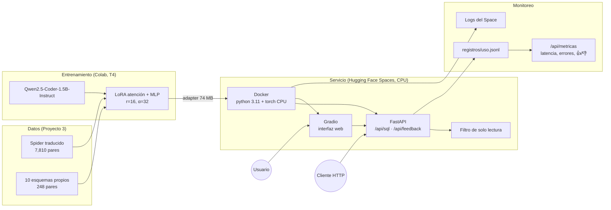

## 6. Herramientas y arquitectura



| Etapa | Herramienta | Por qué |
|---|---|---|
| Datos | MySQL 8.4.10, MarianMT | Mismo motor que usará el usuario; todas las consultas de entrenamiento se validaron por ejecución |
| Entrenamiento | `transformers`, `peft`, Colab T4 | LoRA entrena 18 M de 1,500 M parámetros y cabe en una GPU gratuita |
| Modelo | Base + adapter fusionados con `merge_and_unload` | Sin sobrecosto de LoRA en cada inferencia |
| Servicio | FastAPI + Gradio en un solo proceso | API para integraciones e interfaz para personas, con la misma función `consultar` |
| Despliegue | Docker en Hugging Face Spaces | URL pública gratuita; el modelo base va dentro de la imagen para no descargarlo en cada arranque |
| Seguridad | `es_solo_lectura` | Se bloquea cualquier salida que no sea `SELECT`/`WITH` o que contenga varias sentencias, `INTO OUTFILE` o DDL/DML |
| Monitoreo | JSONL + `/api/metricas` + logs del Space | Cada solicitud guarda pregunta, SQL, latencia y si se bloqueó; el feedback 👍/👎 mide calidad percibida |

### Decisiones

- **CPU en lugar de GPU.** En CPU (fp32) el modelo carga en ~13 s y responde en 7–25 s por pregunta, aceptable para un usuario que antes esperaba a un analista. Evita costos de GPU.
- **Una generación a la vez.** Un candado serializa `generate`; con 2 vCPU, generar en paralelo solo aumenta la latencia de todos.
- **Carga en segundo plano.** El modelo se carga al arrancar en un hilo; `/api/salud` dice `listo: false` mientras tanto, y la primera solicitud espera la carga.
- **Sin ejecución de SQL.** El servicio no se conecta a la base del usuario: devuelve la consulta y el usuario la revisa y ejecuta. Por eso no se usa el ciclo de autocorrección con `ejecutar` del Proyecto 3. Así no hay credenciales ni datos del usuario en el Space.
- **Privacidad del registro.** Se guarda la pregunta y el SQL, pero no el esquema (solo su longitud).
- **Límites de entrada.** Esquema hasta 20,000 caracteres y pregunta hasta 500 (respuesta 422 si no se cumplen).

### API

| Método | Ruta | Entrada | Salida |
|---|---|---|---|
| POST | `/api/sql` | `{"esquema", "pregunta"}` | `{"id", "sql", "solo_lectura", "segundos"}` |
| POST | `/api/feedback` | `{"id", "correcto", "comentario"}` | evento registrado (404 si el `id` no existe) |
| GET | `/api/salud` | | `{"listo", "modelo_base", "usar_adapter", "segundos_carga"}` |
| GET | `/api/metricas` | | solicitudes, errores, latencia p50/p95, tasa de solo lectura, votos y tasa de 👍 |
| GET | `/api/registros` | | registro completo en JSONL |

### Ejecución

Local (Python 3.11):

```bash
python -m venv .venv
.venv/Scripts/pip install -r requirements.txt -r requirements-dev.txt
.venv/Scripts/python -m pytest
.venv/Scripts/python -m uvicorn servicio.api:app --port 7860
```

Docker:

```bash
docker build -t texto-sql .
docker run -p 7860:7860 texto-sql
```

Despliegue en Spaces (requiere `hf auth login` con un token de escritura):

```bash
python scripts/desplegar_space.py <usuario>/texto-sql
```

Variables: `USAR_ADAPTER=0` sirve el modelo base (línea base), `ADAPTER` cambia la ruta del adapter, `DIR_REGISTROS` cambia dónde se guarda el registro y `PRECARGAR=0` desactiva la carga al arrancar.

El almacenamiento del Space gratuito se borra al reiniciar: descargar `/api/registros` periódicamente para conservar la evidencia.
