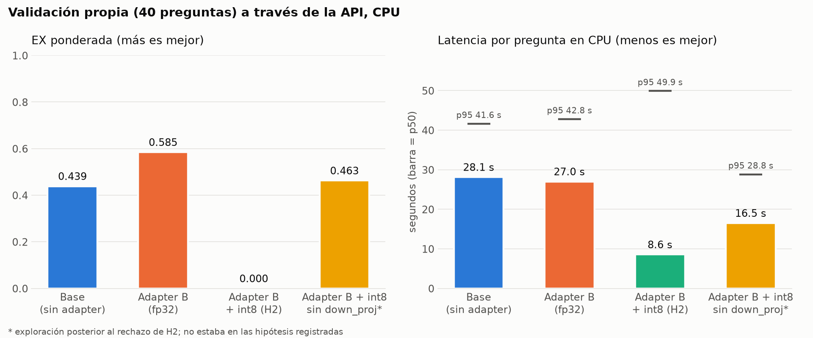

## 4. Modelo planteado

### Proyecto de origen

Proyecto 3 (Text-to-SQL con LoRA, Daniela Ramírez de León y Carlos Daniel Estrada Vega): dado el esquema de una base MySQL 8.4 (`SHOW CREATE TABLE`) y una pregunta en español, el modelo escribe una sola consulta `SELECT` (o `WITH … SELECT`) que la responde. Se eligió este proyecto porque su salida le sirve directamente a una persona ajena al equipo: no necesita entender el modelo, solo revisar y ejecutar la consulta.

### Arquitectura

| Componente | Detalle |
|---|---|
| Modelo base | `Qwen/Qwen2.5-Coder-1.5B-Instruct`: transformer decodificador de 28 capas, 1,544 M parámetros, preentrenado en código y ajustado a instrucciones |
| Adaptación | LoRA r = 16, α = 32, dropout 0.05 sobre **atención y MLP** (`q, k, v, o, gate, up, down`): 18.46 M parámetros entrenables (1.18 % del total). Adapter de 74 MB en `modelo/adapter/` |
| Prompt | Mensaje de sistema (MySQL 8.4, una sola consulta, solo tablas del esquema, `ONLY_FULL_GROUP_BY`) + esquema + pregunta. Es el mismo en entrenamiento e inferencia (`servicio/prompt.py`) |
| Generación | Greedy (`do_sample=False`), hasta 256 tokens nuevos; se extrae la primera sentencia SQL de la respuesta (`servicio/sql_util.py`) |

### Datos de entrenamiento (Proyecto 3)

| Fuente | Pares | Descripción |
|---|---|---|
| Spider (train + dev) | 7,810 | 160 bases recreadas en MySQL 8.4; preguntas traducidas al español con MarianMT protegiendo los literales |
| Esquemas propios | 248 | 10 dominios (clínica, banco, tienda, …) con `COMMENT` y nombres en español, en inglés y abreviados; énfasis en `WITH`, ventanas y fechas |
| **Total** | **8,058** | Todos se ejecutan sin error en MySQL 8.4.10 con `ONLY_FULL_GROUP_BY` (225 descartados) |

Entrenamiento en Colab T4: 1 época, lr 2·10⁻⁴, lote efectivo 16, fp16, loss solo sobre la consulta. Se descartaron 455 ejemplos de más de 2,048 tokens y los pares propios se repitieron 3 veces (8,099 ejemplos efectivos, 141 min).

### Por qué el adapter B

En el Proyecto 3 se compararon dos configuraciones que solo difieren en los módulos con LoRA. Se eligió B (atención + MLP) por tener la mejor EX ponderada en la validación propia y el mejor desempeño en preguntas difíciles:

| Modelo (T4, sin autocorrección) | EX ponderada | Fácil / media / difícil |
|---|---|---|
| Base, sin adapter | 0.439 | 0.92 / 0.57 / 0.21 |
| A: LoRA atención (4.36 M) | 0.598 | 0.92 / 0.71 / 0.43 |
| **B: LoRA atención + MLP (18.46 M)** | **0.646** | 0.75 / 0.71 / 0.57 |

### Cambios para producción y su justificación

| Cambio | Proyecto 3 | Producción | Justificación |
|---|---|---|---|
| Hardware y precisión | GPU T4, fp16 | CPU, fp32 | El servicio corre en la PC del equipo, sin costo de GPU. fp16 en CPU es lento y poco preciso; fp32 es el formato nativo |
| Fusión del adapter | `PeftModel` en cada llamada | `merge_and_unload()` al cargar | Los pesos LoRA se suman una sola vez a la matriz original: la inferencia cuesta lo mismo que el modelo base |
| Autocorrección con `ejecutar` | Hasta 3 llamadas si MySQL devuelve error | Desactivada | El servicio no se conecta a la base del usuario (no guarda credenciales ni datos). Cuesta ~0.04 de EX (0.683 → 0.646 en T4) a cambio de privacidad y de una latencia máxima 3 veces menor (15.3 s → 4.6 s en T4) |
| Filtro de solo lectura | No existía | `es_solo_lectura` antes de responder | El usuario va a ejecutar la consulta en su base; se bloquea cualquier salida con DDL/DML, varias sentencias o `INTO OUTFILE` |
| Cuantización int8 (propuesta, H2) | No existía | `CUANTIZAR=1`, **desactivada** | Cuantización dinámica de las `Linear` del modelo ya fusionado; `lm_head` queda en fp32 porque comparte pesos con los embeddings y decide cada token. Se activaba solo si cumplía H2: baja la latencia a un tercio pero destruye la calidad, así que se rechazó (sección 5) |

No se reentrenó el modelo: el enunciado pide llevarlo a producción, y la evaluación de la sección 5 mide si los cambios de la tabla afectan la calidad.

## 5. Validación de hipótesis

Las hipótesis, la métrica y los criterios están en [docs/hipotesis.md](hipotesis.md), commit `7fd7062`. Se conservan sin cambios. **Limitación de cronología:** el commit registra el 7 de noviembre de 2026 a las 16:52:59 (UTC−06:00), mientras que `base_servicio.json` fecha el final de la corrida base a las 16:43 del mismo día, sin zona horaria. Con la evidencia disponible no se puede acreditar un commit previo a la medición. Los resultados se reportan con esta limitación; no se alteró el historial ni las fechas originales.

Hay un indicio a favor, aunque no verificable por terceros: según el sistema de archivos de la PC donde se midió, `docs/hipotesis.md` se creó el 7 de noviembre a las 16:10:05 y su última modificación tiene esa misma hora. El experimento empezó a las 16:24:03 (creación de su log). Es decir, el criterio se escribió unos 14 minutos antes de la primera medición, y el archivo que se subió en `7fd7062` es ese mismo, sin ediciones posteriores. El commit se hizo mientras la corrida del adapter estaba en curso. Las fechas del sistema de archivos son locales y modificables, así que se reportan como contexto y no como prueba.

### Método

- **Conjunto:** validación propia del Proyecto 3. Son 40 preguntas sobre 2 esquemas que el modelo no vio al entrenar (`farmacia` y `evt_tix`): 12 fáciles, 14 medias y 14 difíciles, con peso 1 / 2 / 3.
- **Cómo se mide:** `python -m evaluacion.experimento` levanta el servicio real (uvicorn + FastAPI) con cada configuración y le envía las 40 preguntas por `POST /api/sql`, una a la vez, igual que un usuario. Las consultas devueltas se ejecutan en MySQL 8.4.10 y se comparan con la referencia.
- **Métricas:**
  - **EX ponderada:** acierto por ejecución.
  - **Latencia:** el campo `segundos` que devuelve la API, reportado como p50 y p95.
  - **Memoria residente del servicio.**
- **Línea base:** el mismo modelo sin adapter (`USAR_ADAPTER=0`), con el mismo prompt.
- **Entorno:** laptop Intel Core Ultra 5 125U (12 núcleos, 15 W, AVX2), 32 GB de RAM, PyTorch 2.15 CPU, fp32, generación greedy.
- **Comprobación del puntuador:** las 40 referencias dan EX = 1.000. Se volvieron a puntuar las 160 predicciones CPU con MySQL 8.4.10; los aciertos coinciden con los CSV guardados. `proyecto3_t4.csv` contiene las métricas agregadas históricas. Las predicciones T4 pregunta por pregunta están en `evaluacion/resultados/proyecto3_t4/`, copiadas sin cambios del repositorio del Proyecto 3 (commit `0eaa760`). Al volver a puntuarlas con este evaluador dan exactamente 0.439 (base) y 0.646 (adapter B).

### Resultados

| Configuración | EX ponderada | Fácil / media / difícil | Correctas | Latencia p50 / p95 | Memoria |
|---|---|---|---|---|---|
| Base, sin adapter (línea base) | 0.439 | 0.92 / 0.57 / 0.21 | 22 / 40 | 28.1 s / 41.6 s | 6.3 GB |
| **Adapter B, fp32 (servicio)** | **0.585** | 0.75 / 0.64 / **0.50** | 25 / 40 | 27.0 s / 42.8 s | 6.3 GB |
| Adapter B + int8 (H2) | 0.000 | 0 / 0 / 0 | 0 / 40 | 8.6 s / 49.9 s | 8.9 GB |
| Adapter B + int8 sin `down_proj`* | 0.463 | 0.92 / 0.64 / 0.21 | 23 / 40 | 16.5 s / 28.8 s | 8.1 GB |

\* Exploración hecha **después** de rechazar H2. No estaba en las hipótesis registradas y no cambia su veredicto.

Detalle por pregunta en `evaluacion/resultados/<config>.csv`; resumen en `evaluacion/resultados/resumen.csv`.

### Veredicto

| Hipótesis | Criterio (definido antes) | Resultado | Decisión |
|---|---|---|---|
| **H1.** El adapter mejora la calidad en producción | EX(B) − EX(base) ≥ 0.10 | 0.585 − 0.439 = **+0.146** | **Se acepta** |
| **H2.** int8 baja la latencia sin perder calidad | p50 ≤ 0.70× y ΔEX ≥ −0.03 | p50 0.32×, pero ΔEX = **−0.585** | **Se rechaza** |
| **H3.** El filtro no bloquea consultas válidas | 0 falsos positivos | 40/40 referencias pasan; 0 predicciones bloqueadas en 160 respuestas | **Se acepta** |

### Análisis

**H1, de dónde sale la mejora.** El adapter gana 7 preguntas que el modelo base falla (4 difíciles: `WITH`, ventanas, subconsultas) y pierde 4 (3 fáciles). Como las difíciles pesan triple, la diferencia ponderada es de +12 puntos sobre 82. También reduce los errores de *columna o tabla inexistente* de 9 a 6. Con solo 40 preguntas, 7 contra 4 no es una diferencia estadísticamente concluyente por sí sola. Lo que la respalda es que coincide en dirección y tamaño con el Proyecto 3 (+0.207 en T4).

**Comparación con T4.** `python -m evaluacion.comparar_t4 --puntuar` compara pregunta por pregunta las predicciones del servicio con las del Proyecto 3 (`evaluacion/resultados/comparacion_t4.md`):

| Modelo | EX T4 | EX CPU | SQL idéntico | Preguntas con resultado distinto |
|---|---|---|---|---|
| Base | 0.439 | 0.439 | 40/40 | ninguna |
| Adapter B | 0.646 | 0.585 | 37/40 | 18 (difícil) y 28 (media), ambas aciertan en T4 |

El modelo base genera exactamente las mismas 40 consultas, así que el prompt, la extracción de SQL y la generación greedy del servicio se comportan igual que en el Proyecto 3. Con el adapter, 3 consultas divergen a mitad de la generación: en la 18 el modelo elige `p.precio` en lugar de `d.precio_unitario`; en la 28 omite la tabla `tkt`; en la 35 ambas versiones fallan. Esas 2 preguntas pesan 5 de 82 puntos, que es toda la diferencia (0.646 − 0.585 = 0.061).

La explicación más probable es numérica: los pesos del adapter son los mismos, pero la T4 usó fp16 y el servicio usa fp32, de modo que el adapter fusionado no queda idéntico y basta un token distinto para que la generación greedy tome otro camino. No se midieron los márgenes de los logits en esos tokens, y las versiones de `transformers` y `peft` también pueden diferir, así que la causa exacta no está demostrada. Lo que sí muestra la comparación es la escala del efecto: diferencias de ~0.06 en este conjunto pueden venir de 2 preguntas.

**Latencia.** La API mide el tiempo total de generación, sin separar prefill y decodificación. El diagnóstico adicional mide una pasada sobre cuatro prompts; su tiempo no debe interpretarse como una descomposición de la latencia de las 40 solicitudes. Las medianas observadas del modelo base y del adapter son próximas (28.1 y 27.0 s); no se midió el efecto de reducir el límite de tokens.

**H2, diagnóstico complementario.** La cuantización dinámica usa una sola escala int8 por tensor para las activaciones. `evaluacion/diagnostico_int8.py` compara el siguiente token predicho en todas las posiciones de 4 prompts reales contra fp32:

| Variante | Acuerdo top-1 con fp32 | Error relativo de logits | Prefill |
|---|---|---|---|
| fp32 (referencia) | 1.000 | 0.000 | 19.4 s |
| int8 por tensor (lo que se probó en H2) | 0.652 | 0.557 | 11.4 s |
| int8 con pesos por canal | 0.644 | 0.542 | 13.6 s |
| int8 con activaciones de 7 bits | 0.652 | 0.557 | 11.2 s |
| int8 sin `down_proj` | 0.936 | 0.207 | 15.6 s |

El diagnóstico se repitió tras corregir la carga de la referencia fp32 y comprueba que esta no contiene capas Linear int8. Sus resultados están en `evaluacion/resultados/diagnostico_int8.json`. Las diferencias entre variantes ayudan a localizar capas sensibles, pero no demuestran por sí solas que los outliers sean la causa: no se instrumentaron las distribuciones de activaciones. La evaluación por API sí muestra pérdida de EX, incluso dejando `down_proj` en fp32 (0.463 frente a 0.585).

Además, int8 **usa más memoria** (8.9 GB contra 6.3 GB), aunque se cuantiza sin copiar el modelo (`inplace=True`). La explicación probable, que no se verificó, es que los pesos empaquetados de oneDNN se suman a los pesos fp32 que el proceso libera pero no devuelve al sistema operativo.

### Decisión para el servicio

- Se recomienda publicar el **adapter B en fp32** (`CUANTIZAR=0`, valor por defecto). Es la configuración elegida: cumple H1 y tiene latencia y memoria similares a las del modelo base en las corridas observadas.
- `CUANTIZAR=1` y `CUANTIZAR=parcial` quedan en el código como evidencia reproducible de H2, no para producción.
- Para bajar la latencia sin perder calidad, el siguiente paso no es int8 dinámico. Las opciones serían:
  - recortar el esquema a las tablas relevantes antes de generar (menos tokens de prefill);
  - cuantizar solo los pesos (*weight-only*, p. ej. con `torchao`), que no toca las activaciones;
  - servir en una máquina con más núcleos o GPU.

### Conclusión en tres frases (para la presentación)

1. El adapter LoRA del Proyecto 3 sigue funcionando en producción: medido a través de la API en CPU, sube la EX ponderada de 0.439 a 0.585 (+0.146, criterio ≥ 0.10), sobre todo en preguntas difíciles (0.21 → 0.50), con latencia y memoria similares en las corridas observadas.
2. La cuantización int8 propuesta para acelerar el servicio se rechazó: baja la latencia a un tercio, pero su EX fue 0.000; por eso se recomienda mantener fp32, con ~27 s por pregunta en una laptop.
3. El filtro de solo lectura no bloqueó ninguna consulta válida en 160 respuestas, sin pérdida de calidad atribuible a bloqueos en este conjunto.
